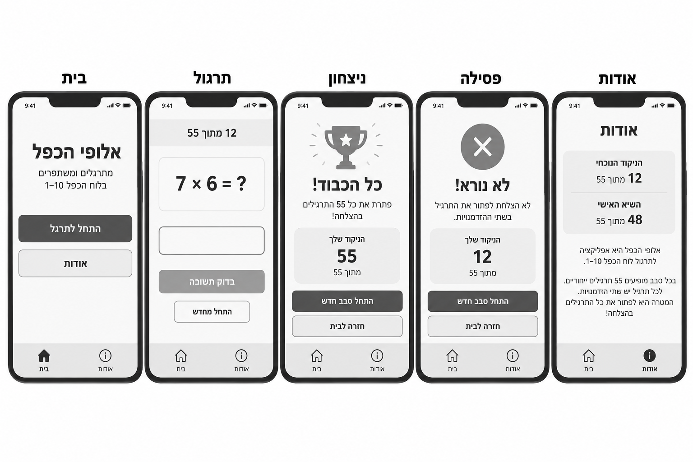
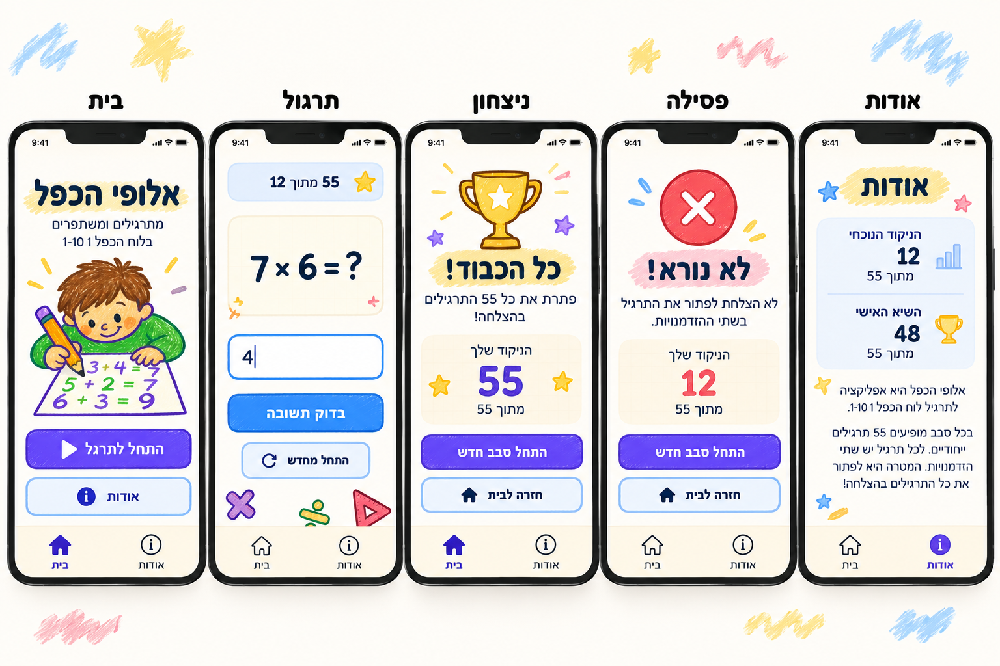
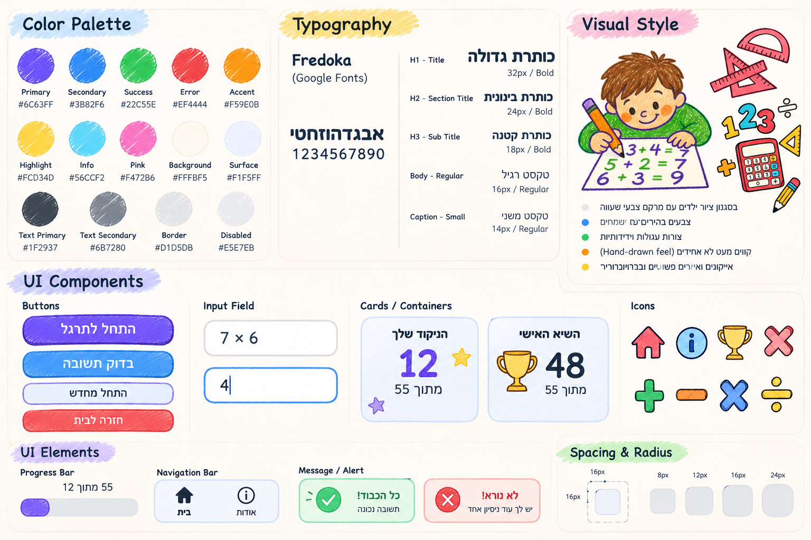

# DESIGN — אלופי הכפל

מסמך עיצוב ממשק עבור אפליקציית Web למובייל בעברית. ה-PRD מגדיר את ההתנהגות והדרישות הפונקציונליות; מסמך זה מגדיר את הצגתן החזותית. תמונות הייחוס ממוקמות לצד המסמך.

## 1. Screens — מסכי האפליקציה

### מקורות חזותיים למבנה ולמראה

**Wireframes — מבנה והיררכיה**

**Mockups — מראה חזותי מיועד**

> **הבחנה חשובה:** ה-PRD מגדיר **שלושה מסכים ראשיים**: בית, תרגול ואודות. בתמונות ה-Wireframes וה-Mockups מופיעים חמישה טלפונים משום ש**ניצחון** ו**פסילה** מוצגים שם כמצבי סיום של מסך התרגול. אין לממש אותם כיעדי ניווט ראשיים נוספים. אם יש אי-התאמה בין דוגמת UI בתמונה ל-PRD, דרישות ה-PRD גוברות. בפרט, מסך אודות חייב לכלול טבלת כפל מלאה 1–10 אף שהיא אינה מוצגת בתמונת ה-Mockups, ואין להוסיף רכיבי UI שאינם נדרשים רק משום שהם מופיעים כהמחשה.

### 1.1 בית

- **מטרה:** נקודת כניסה מזמינה לתרגול.
- **מבנה ותוכן:** כותרת מרכזית גדולה **"אלופי הכפל"**; שורת הסבר קצרה; איור מתמטי של ילד כותב במחברת, בדומה ל-Mockup; כפתור ראשי גדול **"בואו נתרגל!"**. בתחתית: סרגל ניווט.
- **פעולות וניווט:** הכפתור הראשי מוביל לתרגול; סרגל הניווט מאפשר מעבר לבית, תרגול ואודות. בתמונת ה-Mockups מופיע גם כפתור **"אודות"** באזור התוכן של הבית; ניתן לשמרו כקיצור דרך בהתאם למבנה הייחוס, בלי להוסיף יעד חדש.

### 1.2 תרגול

- **מטרה:** פתרון תרגיל כפל אחד בכל פעם, תוך הצגת ההתקדמות בסבב.
- **מבנה ותוכן:** בחלק העליון תג/כרטיס ניקוד בפורמט **"12 מתוך 55"**; במרכז כרטיס תרגיל גדול, לדוגמה **"7 × 6 = ?"**; מתחתיו שדה תשובה מספרית עם גבול ברור; כפתור ראשי **"בדוק תשובה"**; כפתור משני **"התחל מחדש"**; סרגל ניווט תחתון.
- **פעולות וניווט:** הזנת מספר במקלדת המכשיר ובדיקת התשובה; התחלה מחדש בכפוף לאישור; מעבר למסכי בית ואודות בלי לאבד סבב. הודעת הצלחה קצרה, הודעת ניסיון נוסף ואישור התחלה מחדש הם **מצבי UI/הודעות**, לא מסכים חדשים.
- **מצב סיום — ניצחון:** אותו אזור תוכן מתחלף בהמחשת גביע, כותרת ברכה, ניקוד **55 מתוך 55** וכפתור להתחלת סבב חדש. סרגל הניווט נשמר. זהו מצב של תרגול, לא מסך ראשי נפרד.
- **מצב סיום — פסילה:** אותו אזור תוכן מתחלף בסמל פסילה, הודעת סיום, ניקוד הסבב וכפתור **"נסו שוב!"**. סרגל הניווט נשמר. זהו מצב של תרגול, לא מסך ראשי נפרד.
- **הערת נאמנות:** ב-Mockups מופיעים כפתורי **"התחל סבב חדש"** ו**"חזרה לבית"** במצבי הסיום, ואילו ה-PRD מגדיר את פעולת התחלת הסבב מחדש. יש להיצמד לפעולות המאושרות ב-PRD; אין להסיק מהאיור צורך בפיצ'רים נוספים.

### 1.3 אודות

- **מטרה:** הצגת מידע על האפליקציה, ניקוד נוכחי, שיא אישי וטבלת כפל לשימוש כדף עזר.
- **מבנה ותוכן:** כותרת **"אודות"**; כרטיס מידע עם שני מדדים נפרדים: **"הניקוד הנוכחי"** ו**"השיא האישי"**; פסקת הסבר קצרה; **טבלת כפל מלאה 1–10**, שנדרשת ב-PRD אך חסרה בדוגמת ה-Mockup. יש לשלב אותה כחלק מתוכן המסך, עם גלילה אנכית כאשר אינה נכנסת ב-Viewport, בלי להקטין את התאים עד לפגיעה בקריאות.
- **פעולות וניווט:** עיון במידע ובטבלה; מעבר למסכי בית ותרגול באמצעות סרגל הניווט. מצב התרגול נשמר בעת המעבר.

### 1.4 ניווט כללי

סרגל ניווט תחתון עקבי, עם שלושה יעדים בלבד: **"בית"**, **"תרגול"**, **"אודות"**. במוקאפ נראים לעיתים רק שני אייקונים; ביישום יש לתת קדימות לדרישת ה-PRD המפורשת לשלושת היעדים. כל יעד משלב אייקון ותווית בעברית, עם סימון ברור ליעד הפעיל. מצבי ניצחון ופסילה נשארים בתוך יעד **"תרגול"**.

## 2. Style Guide — השפה העיצובית

### 2.1 Color Palette

הגוונים להלן נלקחו מה-Style Guide. יש להשתמש בהם באופן עקבי; רקע בהיר, טקסט כהה וצבעים רוויים לפעולות ולהדגשות.

| שימוש | HEX | תפקיד |
|---|---|---|
| Primary | `#6C63FF` | כפתור מרכזי, סימון פעיל, הדגשות |
| Secondary | `#3B82F6` | כפתור בדיקת תשובה, Focus |
| Success | `#22C55E` | משוב תשובה נכונה |
| Error | `#EF4444` | משוב שגיאה / פסילה |
| Accent | `#F59E0B` | גביעים, פרטים מאוירים |
| Highlight | `#FCD34D` | משיכות הדגשה מאחורי כותרות |
| Info | `#56CCF2` | אייקונים והדגשות מידע |
| Pink | `#F472B6` | הדגשות איור |
| Background | `#FFFBF5` | רקע עמוד בגוון נייר |
| Surface | `#F1F5FF` | רקע כרטיסי ניקוד ומידע |
| Text Primary | `#1F2937` | טקסט עיקרי |
| Text Secondary | `#6B7280` | טקסט משני |
| Border | `#D1D5DB` | מסגרות שדות וכרטיסים |
| Disabled | `#E5E7EB` | רקע רכיב לא פעיל |

### 2.2 Typography

- **משפחת גופנים:** `Fredoka` היא משפחת הגופנים המוצגת ב-Style Guide; יש לוודא בפועל תמיכה תקינה בגליפים בעברית. אם אינה מספקת כיסוי עברי מלא, יש לבחור גופן עברי מעוגל ותואם מבלי לשנות את אופי ההיררכיה. אין להציג גופן חלופי כאילו הוגדר במקור.
- **H1 — כותרת ראשית:** `32px`, `Bold`.
- **H2 — כותרת אזור:** `24px`, `Bold`.
- **H3 — כותרת משנית:** `18px`, `Bold`.
- **Body:** `16px`, `Regular`.
- **Caption:** `14px`, `Regular`.
- **תרגיל וניקוד:** ספרות גדולות ובולטות במיוחד ביחס ל-Body, בהתאם ל-Mockups; לא נקבע גודל מספרי מחייב נוסף ב-Style Guide.

### 2.3 UI Style

- **Buttons:** כפתורים רחבים, מעוגלים, עם טקסט ממורכז ובולט; Primary בסגול, פעולת בדיקת תשובה בכחול, כפתורים משניים על רקע בהיר עם קו מתאר צבעוני. אין לקבוע פעולה לפי צבע בלבד — התווית נדרשת תמיד.
- **Input Field:** שדה תשובה גדול, לבן, עם מסגרת אפורה; בעת Focus מסגרת כחולה ברורה. הספרות קריאות וגדולות, תוך שימוש במקלדת המספרית של המכשיר.
- **Cards / Containers:** משטחים בהירים (`Surface` או גוון נייר), פינות מעוגלות, גבול עדין ותחושת עומק מינימלית. כרטיסי ניקוד כוללים כותרת, מספר גדול ויחידת התקדמות כגון **"מתוך 55"**.
- **Navigation Bar:** פס תחתון בהיר, אייקונים בקו ידידותי ותוויות קצרות; היעד הפעיל מסומן בצבע Primary ובמשקל טיפוגרפי בולט.
- **Icons:** אייקונים צבעוניים, עגולים ובעלי קו מתאר מעט ידני, בהשראת בית, מידע, גביע וסימני פעולות החשבון. יש לשמור על סגנון אחיד בין מסכים.
- **Feedback:** הודעת הצלחה בירוק והודעת טעות באדום, עם סמל מתאים וטקסט בעברית; אין צורך ליצור מסך נפרד למשוב קצר.

### 2.4 Visual Style

- **אווירה:** לימודית, שמחה ונגישה לילדים, בהשראת כלי כתיבה, מחברות, תרגילי חשבון ואיורי צבעי עיפרון.
- **איורים:** דמויות מצוירות בקווי מתאר ידניים, צבעוניות בהירה וטקסטורת עפרונות/גירים; איור הילד הכותב הוא העוגן החזותי במסך הבית. אין להשתמש בצילומי לוח מורכבים כתחליף לאיור ילדותי.
- **צורות וקווי מתאר:** מלבנים מעוגלים, קווים רכים ולעיתים תחושת רישום ידני. פרטי קישוט מתמטיים קטנים אינם צריכים להפריע לקריאת התרגיל.
- **Spacing:** בסיס ריווח המופיע במדריך: `16px`; לשמור על ריווח עקבי בין כרטיסים, שדות וכפתורים.
- **Border Radius:** דוגמאות המופיעות במדריך: `8px`, `12px`, `16px`, `24px`; כפתורים וכרטיסים מרכזיים משתמשים בפינות מעוגלות יותר.
- **Shadows:** הצללות רכות ועדינות בלבד; אין במקור ערכי Shadow מספריים מחייבים.
- **Layout:** קומפוזיציה אנכית המתאימה לטלפון, תוכן מרכזי וקריא, אזורי לחיצה רחבים, וסרגל ניווט תחתון. מסך אודות עשוי לגלול כדי להציג את טבלת הכפל המלאה.

### 2.5 שפה וכיווניות

- **שפה:** עברית בלבד בכל הטקסטים המיועדים למשתמש.
- **כיווניות:** `RTL` ברמת האפליקציה, עם יישור טקסט עברי לימין לפי הצורך; תרגילי כפל וספרות יוצגו בסדר מתמטי ברור ויציב, ללא היפוך של הביטוי.
- **תוויות UI:** יש להשתמש בתוויות המאושרות ב-PRD כאשר הוגדרו; דוגמאות מהאיורים אינן משנות את הדרישות.

## כלל קדימות בעת מימוש

1. **PRD** — קובע מספר מסכים, התנהגות ודרישות חובה.
2. **Wireframes** — קובעים היררכיה, פריסה ומיקום רכיבים ככל שאינם סותרים את ה-PRD.
3. **Style Guide** — קובע צבעים, טיפוגרפיה וסגנון רכיבים.
4. **Mockups** — מדגימים את התוצאה החזותית תוך שמירה על הכללים לעיל.

אין ליצור מסכי ניווט נוספים על סמך תמונות מצבי הסיום, ואין להשמיט את טבלת הכפל או את יעד **"תרגול"** מסרגל הניווט רק משום שאינם מופיעים באופן מלא במוקאפ.
